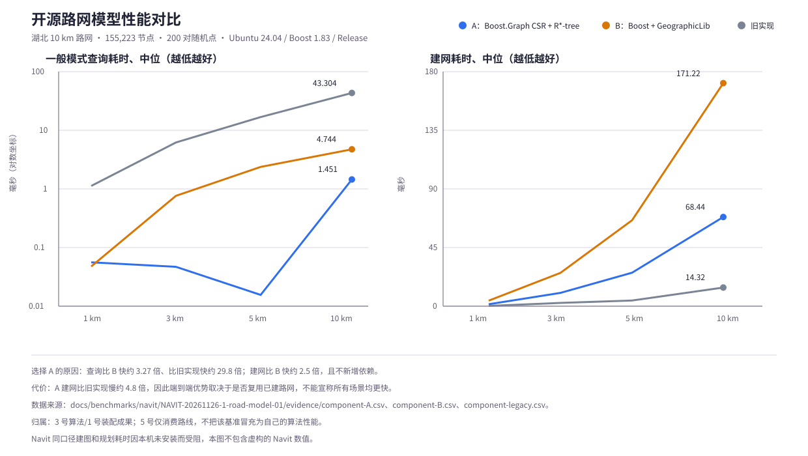

# P1 Linux 组 5 号第二次与第三次作业报告

日期：2026-11-27（Asia/Shanghai）
负责人：P1 Linux 组 5 号
负责模块：LinuxRenderer、Qt 地图展示、导航仪表盘与模拟回放界面

## 结论摘要

5 号在第二次和第三次作业中负责“把其他模块已经产生的数据正确、异步地显示出来”，不负责自行实现路径规划或 HMM 地图匹配。

- 第二次作业完成 Qt Widget/QPainter 地图渲染、瓦片/路线/标记绘制、缓存底图、最新请求去重和后台异步帧提交。
- 第三次作业完成当前位置方向标记、转向卡片、速度/剩余距离/预计时间，以及开始、暂停/继续、停止和 1×/2×/4× 模拟回放。
- 路线来自 3 号接入的开源 Boost.Graph A*；地图匹配来自 3 号接入的 FMM/HMM。5 号消费这些结果，不重新实现算法。
- 路线球面距离、沿路线插值和航向由开源 Boost.Geometry 的 geographic Vincenty 策略计算，已替换手写米制近似公式。
- Qt 本身是本次采用的成熟开源图形框架；Navit 的图形接口只作为工程结构和绘制顺序参考，没有复制其 GPL 源码。
- 旧版导航模拟 4 个用例和 LinuxRenderer 8 个用例曾通过；升级到最新 `main` 并改用 Boost.Geometry Vincenty 后，必须在统一 Ubuntu / Boost 1.83 环境重新运行。统一桌面上的新增控件人工点击也尚未补证据，因此不能把整个团队作业写成“最终验收完成”。

## ① 第二次和第三次任务中 5 号负责的部分

### 第二次作业：LinuxRenderer 与地图显示

5 号负责把显示的输入统一为 `renderer::MapScene`，再输出可显示的一帧图像。主要工作如下：

- 建立 LinuxRenderer 的公共场景模型：逻辑画布尺寸、瓦片、路线、标记和数据版本。
- 完成任务书要求的三段映射：
  - `drawTile -> QPainter::drawImage`
  - `drawRoute -> QPainterPath/QPen`
  - `present/flush -> frameReady(QImage)` 后由 `MapCanvas::paintEvent()` 显示
- 绘制起点、终点、路线、轨迹和导航覆盖层。
- 首次绘制缓存合成后的底图；后续只重绘路线、标记和导航层。
- 通过 `QThreadPool + QFutureWatcher` 在后台生成 `QImage`，结果回到 GUI 线程更新控件。
- 使用请求 ID 忽略旧帧；忙碌时仅保留最新待处理请求，避免任务无限排队。
- 与后续真实数据接入，使地图页消费 `NavigationWorkflow` 中的真实道路、A* 路线和匹配结果。

核心代码：

- `src/pal/linux/renderer/LinuxRenderer.{h,cpp}`
- `src/pal/linux/renderer/MapScene.h`
- `src/ui/map/MapView.cpp`
- `src/ui/map/TilePyramid.{h,cpp}`

### 第三次作业：导航仪表盘与模拟回放

5 号负责展示 4 号导航快照中的内容，不负责真实定位、偏航判定或状态机。实现如下：

- 沿真实 A* 路线生成来源明确标记为 `mock` 的演示快照。
- 沿路线距离、插值点和方位角使用 Boost.Geometry 1.83 计算。
- 在地图内显示带航向的当前位置标记。
- 显示左转、右转、直行和到达提示。
- 显示速度、剩余距离和预计剩余时间。
- 提供开始、暂停、继续、停止和 1×/2×/4× 回放。
- 到达后显示“已到达目的地”，允许重新回放。
- 路线变化或清除时停止旧会话，避免把旧位置画到新路线上。

核心代码：

- `src/ui/map/NavigationSimulation.{h,cpp}`
- `src/ui/map/MapView.cpp`
- `src/pal/linux/renderer/LinuxRenderer.cpp`
- `src/pal/linux/renderer/MapScene.h`
- `tests/NavigationSimulationTests.cpp`

边界说明：`NavigationSimulation` 是供第三次作业界面演示的本地 Mock 驱动，不是 4 号导航状态机。其地理计算已经换成 Boost.Geometry；正式导航仍必须由 4 号提供真实 `NavigationSnapshot`，届时只替换快照来源，不改变 LinuxRenderer 的输入接口。

## ② 对接的组和其他模块

### 组内模块交接

| 对接方 | 提供内容 | 5 号如何使用 | 当前进度 |
| --- | --- | --- | --- |
| 3 号算法模块 | Boost.Graph A* 路线、FMM/HMM 匹配结果、路网图数据 | 将 WGS84 路线转换为屏幕路线；消费匹配轨迹；不自行规划或匹配 | A* 与 FMM 适配已实现；真实 FMM 在湖北数据上 6/6 成功，但单次约 46–48 s、峰值约 1.53 GiB |
| 4 号导航模块 | `NavigationSnapshot`、引导字段、位置/状态契约 | 读取当前位置、航向、速度、剩余距离、时间、转向文本 | 契约、位置源和异步桥已完成；真实导航状态机、GeoClue2、G6 真实联调仍未完成 |
| 2 号数据与存储模块 | 标准 OSM/OSMX、道路、POI、SQLite 缓存 | 通过公共数据契约取道路和几何，不访问私有表 | 标准 OSM/PBF 与 OSMX 已接入；离线包/G7 和用户数据持久化仍待完成 |
| 1 号应用框架模块 | Qt 页面入口、公共主题、CMake、导航工作流、语音页 | 由 `createMapPage()` 注册地图页；复用主题和页面生命周期 | 框架、真实 A* 工作流和语音 PAL 已接入；真人麦克风和扬声器验收未完成 |

### 课程外部组关系

| 外部关系 | 状态与说明 |
| --- | --- |
| G1/G7 数据导入与存储 | 未获得可直接接入的 G1/G7 全部成果。本项目先在 2 号导入/存储路径上完成；G7 离线包仍未完成 |
| G4/G5 路径与匹配 | 3 号采用开源 Boost.Graph A* 与 FMM/HMM，不依赖尚未确认的外部组接口 |
| G6 导航引擎 | 4 号负责真实联调；目前只有契约、位置源和异步桥，不能宣称 G6 已联调 |
| G8/X08 渲染 | 没有确认的 G8 接口。5 号使用本组 Qt Widget/QPainter PAL；Navit 仅作为开源实现参考 |
| G10/X09 语音 | 1 号采用 Piper/Vosk 开源后端；不属于 5 号负责内容 |

## ③ 接口输入、输出和呈现结果

### LinuxRenderer 输入

`renderer::MapScene` 是模块内的只读值对象：

| 字段 | 含义 | 约定 |
| --- | --- | --- |
| `logicalSize` | 场景逻辑尺寸 | 像素 |
| `dataVersion` | 数据版本 | 字符串；缓存失效依据之一 |
| `tiles` | 已完成栅格化的瓦片 | `QImage + QRectF` |
| `routes` | 已转换到屏幕坐标的路线 | 点列、颜色、宽度、层级 |
| `markers` | 起终点、当前位置、POI | 屏幕坐标、类型、颜色、半径、航向 |

另一输入是 `contracts::NavigationSnapshot`：

- 状态和暂停标志；
- 当前 `PositionSample`：坐标、速度、航向、精度；
- 剩余距离、剩余时间；
- `GuidanceInstruction`：转向类型、文字、到动作点距离。

### LinuxRenderer 输出

- `QImage frame`：最终可显示的整帧；
- `QImage baseCache`：缓存底图；
- `QString error`：失败原因；
- `RenderStats`：请求 ID、耗时、缓存命中、瓦片/路线/标记数量；
- `frameReady`：后台完成后回到 GUI 线程发布帧。

### 5 号界面的最终呈现

- 地图瓦片和道路；
- 起终点 A/B；
- 蓝色 A* 路线、绿色轨迹、橙色匹配结果；
- 带方向的当前位置；
- 转向卡片；
- 速度、剩余距离和预计时间；
- 模拟导航控制栏。

### 第三次作业模拟接口

输入：

- `NavigationWorkflow::state().route`；
- WGS84 点列，`QPointF` 的 `x=经度`、`y=纬度`；
- 距离、线路插值和方位角由 Boost.Geometry geographic Vincenty 策略计算；
- 基础速度，默认 8.33 m/s。

输出：

- 带 `source=Mock` 的 `NavigationSnapshot`；
- 当前坐标、航向、速度；
- 已行驶/剩余距离；
- 剩余时间；
- 下一条引导指令。

## ④ 开源算法与性能对比

### 5 号是否自行实现算法

5 号没有自行实现 A*、Dijkstra 或 HMM。导航路线直接使用 3 号集成的：

- **A\***：Boost.Graph `astar_search`，Boost Software License 1.0；
- **HMM 地图匹配**：FMM 固定提交 `19ef34e`，Apache-2.0；
- **路网建模**：后续由 1 号授权、3 号主责，改用 Boost.Graph CSR、Boost.Geometry R*-tree，仍使用 Boost.Graph A*。
- **5 号模拟导航的地理计算**：Boost.Geometry geographic Vincenty，Boost Software License 1.0，不再使用手写的等距圆柱近似。

5 号选择这些成果而不是自行实现，原因是：

1. 3 号已经完成真实源码集成、坐标/图模型适配和回归测试；
2. 复用公共 `RoutePlanner/MapMatcher/MapScene` 边界，避免两套算法结果不一致；
3. A*/HMM 有成熟正确性和开放许可，5 号重复实现只会增加风险和验收面；
4. 渲染层只消费结果，可以让算法和显示并行开发。

### 第三次导航地理计算的开源替换

原模拟代码用“每度约 111195 m + 等距圆柱近似”计算距离和经纬度线性插值，这部分不是开源算法，也不适合作为正式导航实现。现已改为：

| 能力 | 当前实现 | 开源来源 |
| --- | --- | --- |
| 两点/折线距离 | Boost.Geometry `distance` + WGS84 spheroid | Boost 1.83，BSL-1.0 |
| 沿折线指定距离取点 | Boost.Geometry `line_interpolate` | Boost 1.83，BSL-1.0 |
| 航向/方位角 | Boost.Geometry `azimuth` | Boost 1.83，BSL-1.0 |
| 公式策略 | geographic Vincenty | Boost 1.83，BSL-1.0 |

选择 Vincenty 的原因是采用 WGS84 椭球、精度比手写等距近似高，并且不新增第三方依赖；Andoyer 虽更快但属于近似算法，Thomas 也未在当前项目形成实测数据。因此本次先接入团队已有的 Boost.Geometry 技术栈，后续如需要速度优化，可在同一 API 下比较 Vincenty/Andoyer，而不改业务接口。

### 本地实测的本组算法组合对比

项目后续对“自写路网建模”和两种开源组合做了同机实测。该数据不属于 5 号算法产出，而是 5 号路线显示所依赖的算法链路，必须如实标为 **3 号算法/1 号装配成果**。

数据来源：`docs/benchmarks/navit/NAVIT-20261126-1-road-model-01/evidence/component-*.csv`。环境为 Ubuntu 24.04.5、Boost 1.83、GCC 13.3、Release，湖北缓存，10 km 路网含 155,223 个节点；每档 200 对随机点。

| 方案 | 组成 | 10 km 一般模式查询中位 | 建网中位 | 适用判断 |
| --- | --- | ---: | ---: | --- |
| 旧自写实现 | 每次重建 adjacency list、网格/线性吸附 | 43.304 ms | 14.32 ms | 查询慢；仅作基线 |
| A：Boost 一体 | Boost.Graph CSR + `filtered_graph` + Boost.Geometry R*-tree + tmerc/haversine | **1.451 ms** | 68.44 ms | 查询最快、依赖不增加、内存低，最终选用 |
| B：Boost + GeographicLib | Boost.Graph + R*-tree + GeographicLib LocalCartesian/geodesic | 4.744 ms | 171.22 ms | 椭球精度略高，但慢且增加依赖，最终清理 |

选择 A 的具体原因：

- 查询比 B 快约 3.27 倍，比旧实现快约 29.8 倍。
- 建网约比 B 快 2.5 倍。
- 10 km 组件峰值 RSS：A 139.1 MiB，B 149.4 MiB，旧实现 148.4 MiB。
- 端到端城区一般路线：A 64.5 ms，B 82.9 ms；跨城一般路线：A 392.2 ms，B 497.1 ms。
- B 的椭球边长只带来约 0.04%–0.2% 的长度差，对当前选路影响很小，却增加依赖和查询成本。

代价也必须报告：A 的建网比旧实现慢约 4.8 倍。因此每次扩大区域或重建分级路网时，端到端不一定更快；优势主要出现在路网已加载、需要多次吸附和查询的交互阶段。

### 与 Navit 的关系

Navit 是持续对标项目，但本次没有可用的同口径 Navit 运行结果：

- 5 号读取过 Navit `graphics.h`、`graphics.c` 和 Qt5 图形后端，参考“准备数据→按层绘制→整帧提交”的结构；
- Navit 为 GPL v2，本项目没有复制其源码，只保留架构映射；
- 当前机器没有可用于同视野、同缩放、同路线密度的 Navit 帧计时，因此不虚构 FPS 或性能倍数；
- 路网报告同样记录 Navit 未安装、建图/规划耗时受阻。

## ⑤ 其他组接口是否由 AI 自行补写

| 检查项 | 当前实现 | 结论 |
| --- | --- | --- |
| A*/路径规划 | 3 号的 Boost.Graph A* | 未自行补写，符合要求 |
| HMM/地图匹配 | 3 号 FMM `19ef34e` | 未自行补写，符合要求 |
| 路网图、投影、吸附 | 后续采用 Boost.Graph/Boost.Geometry | 使用开源成果并适配 |
| 导航快照契约 | `include/contracts/NavigationTypes.h` 由 4 号设计、1 号维护 | 5 号只消费，不改契约 |
| 导航状态机/偏航重算 | 4 号负责，当前未完成 | 5 号不冒充已完成 |
| 5 号模拟驱动的路线插值 | 已使用 Boost.Geometry Vincenty | 开源实现；没有保留 AI 手写经纬度插值公式 |
| 5 号模拟驱动的导航状态 | `NavigationSimulation` 为界面演示适配器 | 来源始终标记 `mock`，不能替代 4 号状态机或 G6 联调证据 |
| 语音、存储、GeoClue2 | 分别由 1/2/4 号负责 | 5 号未自写替代 |

这里的剩余风险必须明确：由于 4 号真实导航状态机尚未交付，第三次作业中的速度、剩余距离和转向数据由 5 号 Mock 驱动生成，仅用于验证界面。正式接入时应把这个来源替换成 4 号真实快照，而不是把 AI 编写的 Mock 当成“其他组接口成果”。

## ⑥ 软件功能确认

已完成的模块级验证：

| 验证 | 结果 |
| --- | --- |
| Boost.Geometry 改造前：路线推进、暂停/继续、倍速、到达、非法路线 | 4/4 通过 |
| Boost.Geometry 路线长度、插值和方位角 | 已加入测试；需在 Ubuntu / Boost 1.83 环境重新构建确认 |
| LinuxRenderer 场景、缓存、校验、导航覆盖层、异步旧帧丢弃 | 8/8 通过 |
| `MapView.cpp` 编译 | 通过 |
| 无语音构建路径的 `MainWindow.cpp` / `main.cpp` 编译 | 通过 |
| 离屏预览 | 路线、起终点、当前位置方向标记和转向卡进入同一帧 |

验证环境为 Windows Qt 6.12 / MinGW 13.1，是编译与逻辑冒烟，不是团队统一的 Ubuntu 24.04 / Qt 6.4.2 最终验收环境。团队主线的历史 Ubuntu 地图首帧、Wayland 截图和 CTest 结果可作为环境基础，但不能自动证明本分支新增控件已经完成人工点击验收。

最终功能判断：

- Boost.Geometry 改造前的渲染和展示模块自动化检查通过；
- Boost.Geometry 改造后的代码已经基于最新 `main` 重新适配，但仍需在统一 Ubuntu / Boost 1.83 环境完成一次编译和测试，不能把尚未执行的构建写成通过；
- 真实 A* 路线和 FMM 匹配结果可以被地图消费；
- 模拟导航可以运行和结束；
- 真实团队闭环仍需 4 号状态机、GeoClue2、G6 联调，以及统一 Ubuntu 桌面上的最终人工演示。

因此本报告确认“本人模块代码功能正常”，但不把团队尚未完成的跨组联调写成“整个软件全部验收完成”。

## 参考资料

- `docs/renderer/linux-renderer.md`
- `docs/assignment-3-navigation-ui.md`
- `docs/navigation-contracts.md`
- `docs/benchmarks/navit/NAVIT-20261101-5-renderer-01.md`
- `docs/benchmarks/navit/NAVIT-20261126-1-road-model-01.md`
- `docs/benchmarks/navit/NAVIT-20261127-1-track-matching-01.md`
- `decision_log.md`：`DEC-20261101-3-open-source-01`、`DEC-20261101-5-renderer-01`、`DEC-20261126-1-road-model-01`
